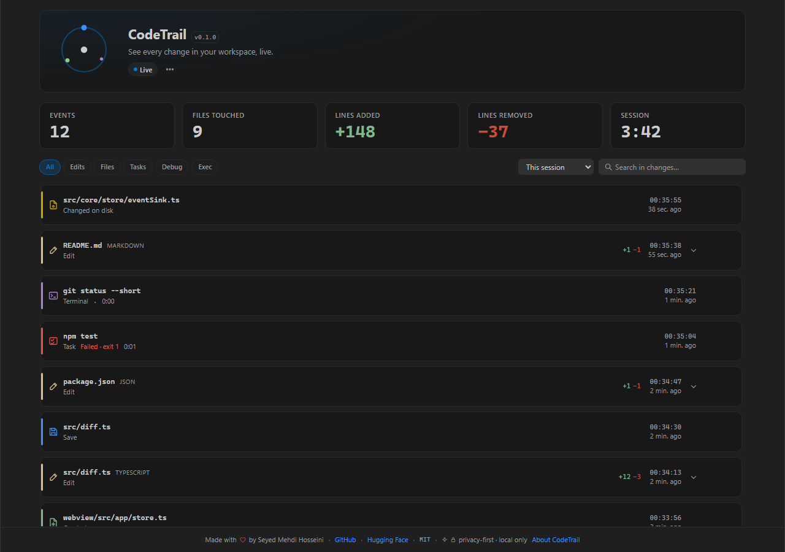
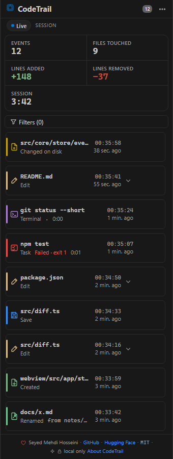
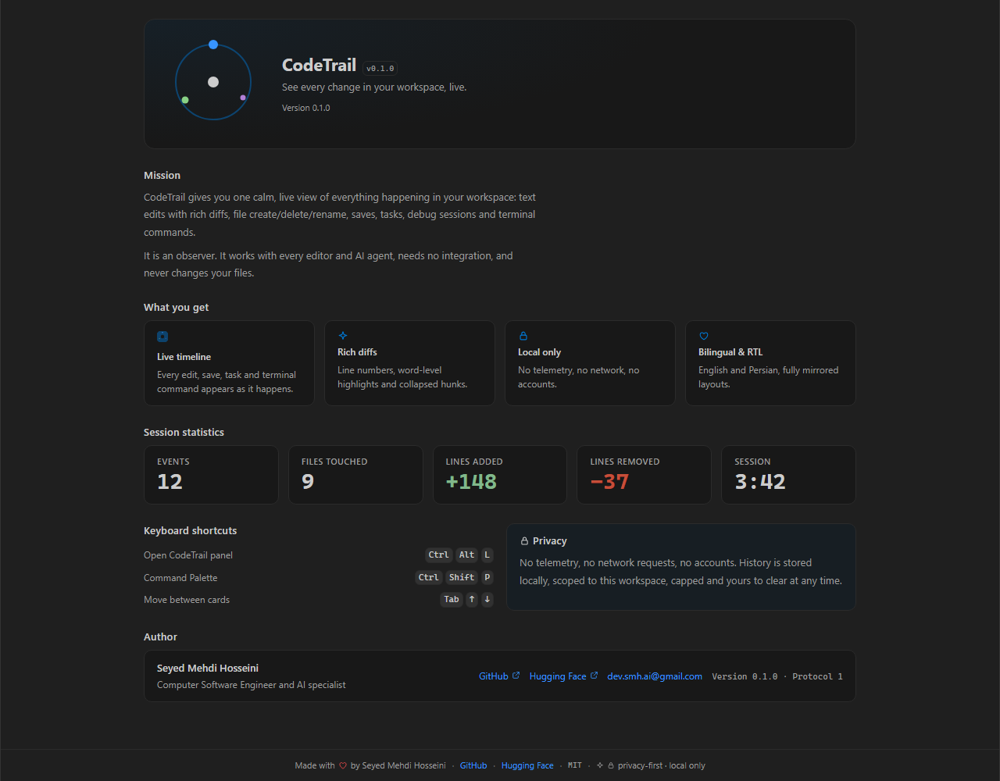
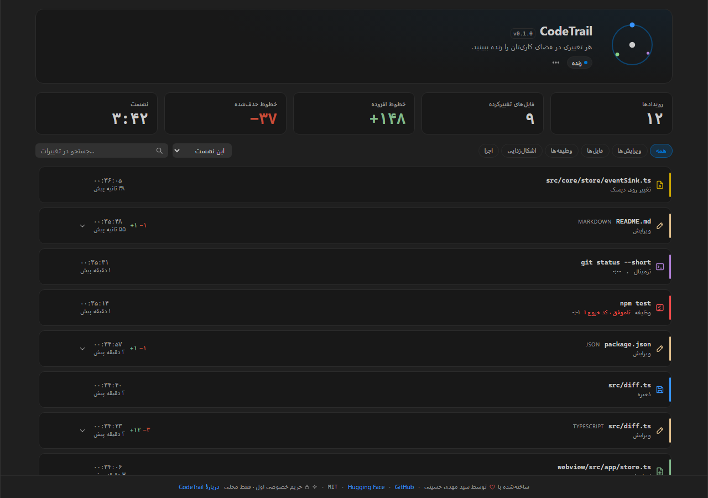
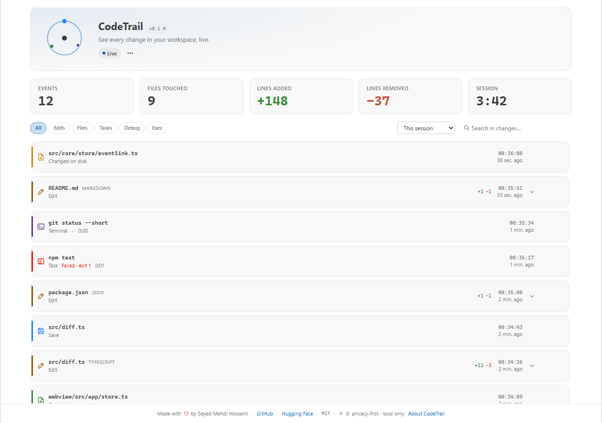

# CodeTrail

**See every change in your workspace, live.**

[English](#english) · [فارسی](#فارسی)

---

## English

CodeTrail is a local-first VS Code extension that turns everything happening in your
workspace into one calm, live timeline: text edits with line- and word-level diffs, file
create / delete / rename, saves, on-disk changes, tasks, debug sessions, and terminal
commands when VS Code shell integration is available.

It is an **observer**. It never edits your files, needs no agent integration, and sends
nothing over the network. History is stored in the workspace and can be paused or cleared
at any time.

> Marketplace listing: **CodeTrail Live** · extension ID `smh-dev-ai.codetrail`.
> The Marketplace display name carries a "Live" qualifier because the bare display name
> "CodeTrail" is already used by another publisher; the product, repository, commands and
> UI are simply **CodeTrail**.

### Highlights

- **Live, not a log file.** Edits are grouped into readable bursts and appear while you
  type, save, or while an agent works.
- **Real diffs.** Added/removed lines, hunks with context, old/new line numbers, and
  word-level highlights; oversized diffs degrade to explicit truncation states.
- **Agent-agnostic.** Works with editor-integrated agents and with CLI agents that write
  directly to disk; no plugins, protocol, or API key required.
- **Observer only.** Read-only access to documents and the file watcher; never writes.
- **Theme-native.** Colors, fonts, and surfaces come from the active VS Code theme,
  including light, dark, and high contrast.
- **Bilingual.** English and Persian with correct RTL layout and LTR-isolated code.
- **Private by default.** No telemetry, no network calls, no remote assets.

### Works with any agent

CodeTrail does not hook into any specific assistant. It listens to VS Code's own events,
so the same feed works for every tool and every project:

| What you use | How it appears | Diff detail |
| --- | --- | --- |
| VS Code–integrated agents (GitHub Copilot, Claude Code, Cursor, Continue, Codex, …) | Edit events from the editor API | Full line and word-level diff |
| CLI / terminal agents (Claude Code CLI, Codex CLI, aider, scripts) | File watcher events on disk | File, time and kind (no line diff) |
| You, editing by hand | Edit and save events | Full diff |
| Tasks, debug sessions, terminal | Task / debug / shell-integration events | Exit codes and command text |

Everything happens automatically after installation: activation is `onStartupFinished`,
every workspace is tracked independently, and there is no per-project configuration file.
If a CLI agent rewrites a file on disk, CodeTrail reports the file and time; line diffs for
those external writes are not reconstructed today.

### Features

| | |
| --- | --- |
| Live activity timeline | Sidebar and full editor panel, newest first, virtualized for long sessions |
| Rich edit diffs | Myers / length-weighted DP, configurable context, word marks, truncation states |
| Workspace events | Create, delete, rename, save, and external on-disk changes |
| Tool events | Task start/end with exit code, debug sessions, terminal commands |
| Stats | Events, files touched, added/removed lines, session duration |
| Filters and search | By kind, file, time range, and free text; case-insensitive |
| Export | JSON and Markdown through the native save dialog |
| Commands and keys | Command Palette, status bar, `Ctrl+Alt+L` / `Cmd+Alt+L` |

### Screenshots

| Panel | Sidebar |
| --- | --- |
|  |  |

| About | Persian (RTL) |
| --- | --- |
|  |  |



### Install

1. **Marketplace** (once published): open Extensions, search for **CodeTrail Live**, install.
2. **VSIX**: download `codetrail-0.1.0.vsix` from the
   [latest release](https://github.com/SMH-AI-Dev/CodeTrail/releases/latest) and run
   `code --install-extension codetrail-0.1.0.vsix`.
3. Reload the window. CodeTrail starts tracking this workspace automatically.

### First 30 seconds

1. Open the **CodeTrail** icon in the Activity Bar, or run **CodeTrail: Open Live Activity**.
2. Edit a file or let an agent work; cards appear with diffs as changes settle.
3. Click a card to expand its diff, use the filter row to focus on edits, files, tasks,
   debug, or terminal, and pause tracking from the title bar when you need quiet.

### Commands

- `CodeTrail: Open Live Activity`
- `CodeTrail: Pause / Resume Tracking`
- `CodeTrail: Clear Activity`
- `CodeTrail: Export Activity as JSON`
- `CodeTrail: Export Activity as Markdown`
- `CodeTrail: About CodeTrail`

### Settings

All settings are under `codetrail.*` and are scoped per window (workspace):

| Setting | Default | Purpose |
| --- | --- | --- |
| `codetrail.enabled` | `true` | Track activity in this window |
| `codetrail.maxEvents` | `1000` | Events kept in memory and history (100–5000) |
| `codetrail.maxDiffLines` | `500` | Diff lines stored per change |
| `codetrail.contextLines` | `3` | Unchanged lines around each hunk |
| `codetrail.debounceMs` | `300` | Idle time before a burst becomes one event |
| `codetrail.persistHistory` | `true` | Keep history in workspace storage between sessions |
| `codetrail.trackFileOperations` | `true` | Create, delete, rename, and external change events |
| `codetrail.trackExternalChanges` | `true` | On-disk changes made outside the editor |
| `codetrail.trackTasks` | `true` | Task start, finish, and exit status |
| `codetrail.trackDebug` | `true` | Debug session start and end |
| `codetrail.trackTerminal` | `true` | Terminal commands (requires shell integration) |
| `codetrail.excludeGlobs` | common build folders | Paths excluded from tracking |
| `codetrail.maxFileSizeKB` | `2048` | Documents larger than this are not diffed |
| `codetrail.statusBar` | `true` | Status bar item |
| `codetrail.locale` | `auto` | Interface language: `auto`, `en`, or `fa` |
| `codetrail.openFilesOutsideWorkspace` | `false` | Also track files opened outside the workspace (name only) |

### Privacy and data

- No server, no telemetry, no network requests, no remote assets.
- History lives in VS Code workspace storage for this project only, capped in size, and can
  be disabled or cleared at any time.
- Terminal command text can contain secrets. It is stored locally only; disable
  `codetrail.trackTerminal` if you do not want it captured.
- Files outside the workspace are ignored unless you opt in, and then only their file name
  is shown.

### Development

```bash
npm install
npm run check             # typecheck + lint + unit/webview tests + production build
npm run watch             # extension + webview watch build
npm run dev:webview       # preview shell in a browser (mock host)
npm run test:integration  # real VS Code integration suite
npm run package           # codetrail-0.1.0.vsix
```

Architecture and design notes live in [docs/ARCHITECTURE.md](docs/ARCHITECTURE.md).

### License

MIT © 2026 Seyed Mehdi Hosseini

---

<div dir="rtl" lang="fa">

## فارسی

**CodeTrail** یک اکستنشن محلی برای VS Code است که همه‌چیزِ در حال اتفاق در فضای کاری را
به یک خط زمانی زنده و آرام تبدیل می‌کند: ویرایش‌های متنی با تفاوتِ خطی و کلمه‌ای، ساخت، حذف
و تغییر نام فایل، ذخیره‌ها، تغییرهای روی دیسک، وظیفه‌ها، نشست‌های اشکال‌زدایی و فرمان‌های
ترمینال (در صورت فعال بودن یکپارچه‌سازی پوستهٔ VS Code).

CodeTrail فقط **ناظر** است: فایل‌های شما را تغییر نمی‌دهد، به یکپارچه‌سازی با ایجنت خاصی
نیاز ندارد و هیچ داده‌ای را به شبکه نمی‌فرستد. تاریخچه در فضای کاری همان پروژه ذخیره
می‌شود و هر لحظه می‌توانید رهگیری را متوقف یا تاریخچه را پاک کنید.

> نام نمایشی در Marketplace به شکل **CodeTrail Live** است (شناسهٔ `smh-dev-ai.codetrail`).
> دلیل افزودن «Live» این است که نام نمایشی دقیق «CodeTrail» پیش‌تر توسط ناشری دیگر
> گرفته شده؛ خودِ محصول، مخزن، فرمان‌ها و رابط کاربری **CodeTrail** هستند.

### نکته‌های اصلی

- **زنده، نه یک فایل لاگ.** ویرایش‌ها در قالب خوشه‌های خوانا گروه‌بندی می‌شوند و همان
  زمانی که تایپ می‌کنید، ذخیره می‌کنید یا یک ایجنت کار می‌کند نمایش داده می‌شوند.
- **تفاوت‌های واقعی.** خطوط افزوده/حذف‌شده، بخش‌های دارای زمینه، شمارهٔ خط قدیم و جدید و
  برجسته‌سازی در سطح کلمه؛ تفاوت‌های بزرگ با وضعیت کوتاه‌سازی صریح نمایش داده می‌شوند.
- **مستقل از ایجنت.** هم با ایجنت‌های داخل VS Code کار می‌کند و هم با ایجنت‌های CLI که
  مستقیم روی دیسک می‌نویسند؛ بدون افزونه، پروتکل یا کلید API.
- **فقط ناظر.** دسترسی فقط‌خواندنی به سندها و watcher فایل؛ هیچ نوشتنی انجام نمی‌شود.
- **هماهنگ با تم.** رنگ‌ها، فونت‌ها و سطوح از تم فعال VS Code می‌آیند، شامل روشن، تیره و
  کنتراست بالا.
- **دوزبانه.** انگلیسی و فارسی با چیدمان راست‌به‌چپ صحیح و جدا نگه‌داشتن کد چپ‌به‌راست.
- **حریم خصوصی به‌صورت پیش‌فرض.** بدون تلمتری، بدون درخواست شبکه و بدون دارایی راه دور.

### سازگاری با هر ایجنت

CodeTrail به هیچ دستیار خاصی متصل نمی‌شود و فقط رویدادهای خود VS Code را گوش می‌دهد؛
بنابراین یک فید برای همهٔ ابزارها و همهٔ پروژه‌ها کار می‌کند:

| ابزار شما | نحوهٔ نمایش | جزئیات تفاوت |
| --- | --- | --- |
| ایجنت‌های داخل VS Code (GitHub Copilot، Claude Code، Cursor، Continue، Codex و…) | رویداد ویرایش از API ادیتور | تفاوت کامل خطی و کلمه‌ای |
| ایجنت‌های CLI و ترمینالی (Claude Code CLI، Codex CLI، aider، اسکریپت‌ها) | رویداد watcher روی دیسک | فایل، زمان و نوع (بدون تفاوت خطی) |
| ویرایش دستی خودتان | رویداد ویرایش و ذخیره | تفاوت کامل |
| وظیفه‌ها، اشکال‌زدایی و ترمینال | رویدادهای مربوطه | کد خروج و متن فرمان |

همه‌چیز پس از نصب خودکار است: فعال‌سازی با `onStartupFinished` انجام می‌شود، هر فضای
کاری جداگانه رهگیری می‌شود و هیچ فایل پیکربندی در پروژه لازم نیست. اگر یک ایجنت CLI
فایلی را روی دیسک بازنویسی کند، CodeTrail فایل و زمان را نشان می‌دهد؛ امروز تفاوت خطی
برای این نوشتن‌های بیرونی بازسازی نمی‌شود.

### امکانات

| | |
| --- | --- |
| خط زمانی زندهٔ فعالیت | نوار کنار و پنل کامل ادیتور، جدیدترین اول، مجازی‌سازی برای نشست‌های طولانی |
| تفاوت‌های غنی | Myers / DP وزن‌دار طول، زمینهٔ قابل تنظیم، علامت‌گذاری کلمه، کوتاه‌سازی صریح |
| رویدادهای فضای کاری | ساخت، حذف، تغییر نام، ذخیره و تغییرهای روی دیسک |
| رویدادهای ابزار | شروع/پایان وظیفه با کد خروج، نشست اشکال‌زدایی، فرمان ترمینال |
| آمار | رویدادها، فایل‌های لمس‌شده، خطوط افزوده/حذف‌شده، مدت نشست |
| فیلتر و جست‌وجو | بر اساس نوع، فایل، بازهٔ زمانی و متن آزاد؛ بدون حساسیت به بزرگی حروف |
| خروجی | JSON و Markdown از طریق پنجرهٔ ذخیرهٔ بومی |
| فرمان‌ها و کلیدها | Command Palette، نوار وضعیت، `Ctrl+Alt+L` / `Cmd+Alt+L` |

### تصاویر

| پنل | نوار کنار |
| --- | --- |
|  |  |

| درباره | فارسی (راست‌به‌چپ) |
| --- | --- |
|  |  |


### نصب

1. **Marketplace** (پس از انتشار): بخش Extensions را باز کنید، **CodeTrail Live** را جست‌وجو
   و نصب کنید.
2. **VSIX**: فایل `codetrail-0.1.0.vsix` را از
   [آخرین ریلیز](https://github.com/SMH-AI-Dev/CodeTrail/releases/latest) دریافت و اجرا کنید:
   `code --install-extension codetrail-0.1.0.vsix`.
3. پنجره را دوباره بارگذاری کنید. CodeTrail به‌صورت خودکار رهگیری این فضای کاری را آغاز
   می‌کند.

### سی ثانیهٔ اول

1. آیکون **CodeTrail** را در Activity Bar باز کنید یا فرمان
   **CodeTrail: Open Live Activity** را اجرا کنید.
2. فایلی را ویرایش کنید یا اجازه دهید یک ایجنت کار کند؛ کارت‌ها همراه با تفاوت‌ها ظاهر
   می‌شوند.
3. با کلیک روی کارت، تفاوت باز می‌شود؛ با ردیف فیلتر روی ویرایش‌ها، فایل‌ها، وظیفه‌ها،
   اشکال‌زدایی یا ترمینال تمرکز کنید و در صورت نیاز از نوار عنوان رهگیری را متوقف کنید.

### فرمان‌ها

- `CodeTrail: Open Live Activity`
- `CodeTrail: Pause / Resume Tracking`
- `CodeTrail: Clear Activity`
- `CodeTrail: Export Activity as JSON`
- `CodeTrail: Export Activity as Markdown`
- `CodeTrail: About CodeTrail`

### تنظیمات

همهٔ تنظیمات زیر `codetrail.*` هستند و برای هر پنجره (فضای کاری) اعمال می‌شوند:

| تنظیم | پیش‌فرض | کارکرد |
| --- | --- | --- |
| `codetrail.enabled` | `true` | رهگیری فعالیت در این پنجره |
| `codetrail.maxEvents` | `1000` | تعداد رویدادهای نگه‌داشته‌شده در حافظه و تاریخچه (۱۰۰ تا ۵۰۰۰) |
| `codetrail.maxDiffLines` | `500` | تعداد خطوط تفاوت ذخیره‌شده برای هر تغییر |
| `codetrail.contextLines` | `3` | خطوط بدون تغییر اطراف هر بخش |
| `codetrail.debounceMs` | `300` | زمان بی‌کاری پیش از تبدیل یک خوشهٔ ویرایش به یک رویداد |
| `codetrail.persistHistory` | `true` | نگه‌داشتن تاریخچه در فضای ذخیره‌سازی فضای کاری |
| `codetrail.trackFileOperations` | `true` | رویداد ساخت، حذف، تغییر نام و تغییر بیرونی |
| `codetrail.trackExternalChanges` | `true` | تغییرهای روی دیسک که بیرون از ادیتور انجام می‌شوند |
| `codetrail.trackTasks` | `true` | شروع، پایان و کد خروج وظیفه |
| `codetrail.trackDebug` | `true` | شروع و پایان نشست اشکال‌زدایی |
| `codetrail.trackTerminal` | `true` | فرمان‌های ترمینال (نیازمند یکپارچه‌سازی پوسته) |
| `codetrail.excludeGlobs` | پوشه‌های رایج ساخت | مسیرهای مستثنا از رهگیری |
| `codetrail.maxFileSizeKB` | `2048` | سندهای بزرگ‌تر از این مقدار تفاوت‌گیری نمی‌شوند |
| `codetrail.statusBar` | `true` | نمایش آیتم نوار وضعیت |
| `codetrail.locale` | `auto` | زبان رابط: `auto`، `en` یا `fa` |
| `codetrail.openFilesOutsideWorkspace` | `false` | رهگیری فایل‌های باز‌شده بیرون از فضای کاری (فقط نام) |

### حریم خصوصی و داده‌ها

- بدون سرور، بدون تلمتری، بدون درخواست شبکه و بدون دارایی راه دور.
- تاریخچه فقط در فضای ذخیره‌سازی همین پروژه در VS Code می‌ماند، حجم آن محدود است و هر
  زمان می‌توانید آن را غیرفعال یا پاک کنید.
- متن فرمان ترمینال می‌تواند حاوی اطلاعات حساس باشد. این متن فقط محلی ذخیره می‌شود؛ اگر
  نمی‌خواهید ثبت شود، `codetrail.trackTerminal` را خاموش کنید.
- فایل‌های بیرون از فضای کاری نادیده گرفته می‌شوند، مگر آنکه خودتان اجازه دهید؛ در آن حالت
  فقط نام فایل نمایش داده می‌شود.

### توسعه

```bash
npm install
npm run check             # typecheck + lint + تست‌های واحد/وب‌ویو + بیلد production
npm run watch             # بیلد حالت watch برای اکستنشن و وب‌ویو
npm run dev:webview       # پیش‌نمایش در مرورگر با هاست ساختگی
npm run test:integration  # تست یکپارچه روی VS Code واقعی
npm run package           # ساخت codetrail-0.1.0.vsix
```

یادداشت‌های معماری در [docs/ARCHITECTURE.md](docs/ARCHITECTURE.md) قرار دارد.

### مجوز

MIT © 2026 Seyed Mehdi Hosseini

</div>
