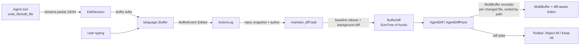

# Zed & Dyad — Live Change Display / Diff Review Research for CodeTrail

Research date: **2026-11-21**. Purpose: extract architecture, data flow, algorithms and UX
patterns for live change display and diff review that can inform CodeTrail (read-only VS Code
observer, see `docs/PROJECT.md`). Findings are also checked against the CodeTrail contract in
`docs/ARCHITECTURE.md` (`src/diff.ts`, `src/core/diff/*`, `src/core/tracking/*`).

| Tag | Meaning |
| --- | --- |
| `[Observed in source]` | Read directly in the cloned repository at the commit below. |
| `[Inferred]` | Reasoned conclusion from source, not stated outright. |
| `[Unknown]` | Not verifiable within the coverage of this study. |

> **Supervisor scope note (2026-11-21):** CodeTrail's product is a *timeline of discrete change
> events*, not a persistent per-file review session. Adopt from Zed: a per-document baseline,
> cheap prefix/suffix recomputation, hunk shape, explicit card states, and path/time ordering.
> Do **not** implement anchored cross-burst hunk identity, an advancing "review baseline",
> keep/reject, checkpoints, or editor-injected hunk controls in v1 — they require write
> authority or a persistent review model that this observer does not own. The per-event diff
> model in `docs/ARCHITECTURE.md` stands.

All source paths below are relative to each repo root in the temp clone; absolute paths are
given in §8.

## 0. Repositories and coverage

| Target | Remote | HEAD | Clone |
| --- | --- | --- | --- |
| Zed | `https://github.com/zed-industries/zed.git` | `2f808b3c2de049ecfdbad0fdb26763cebfcaa3b4` (authored 2026-11-21T00:49:01Z) | `--depth 1 --filter=blob:none --sparse` |
| Dyad | `https://github.com/dyad-sh/dyad.git` | `56cc3964a8983296a1f49d511cb8afde1719c6f3` | `--depth 1` (full tree) |

Zed sparse-checkout set: `crates/editor`, `crates/agent`, `crates/agent_ui`, `crates/agent_settings`,
`crates/project`, `crates/gpui`, `crates/git`, `crates/git_ui`, `crates/git_ui_core`,
`crates/buffer_diff`, `crates/action_log`, `crates/acp_thread`, `crates/multi_buffer`,
`crates/language`, `crates/text`, `crates/paths`, `docs`, `assets/keymaps`.
Not checked out: `ui`, `workspace`, `notifications`, `sum_tree`, `project_panel`, `collab`,
`cli`, `evals` — claims referencing those crates are `[Unknown]` or indirect.
Dyad: complete source tree except `node_modules` (not installed, never executed).

## 1. Zed — architecture

### 1.1 The core idea: "diff base + anchored hunks per buffer"

Zed does **not** compute a repo-wide diff for review. The unit is a **per-buffer diff against
a per-buffer *diff base* (baseline text)** held in `BufferDiff`.

- `crates/buffer_diff/src/buffer_diff.rs`: `struct BufferDiff { buffer_id, base_text_buffer,
  diff_snapshot, secondary_diff, buffer_snapshot, operations }` `[Observed in source]`
- `BufferDiffSnapshot { hunks: SumTree<InternalDiffHunk>, pending_hunks: SumTree<PendingHunk>,
  base_text, base_text_exists, buffer_snapshot, secondary_diff }` `[Observed in source]`
- `InternalDiffHunk { buffer_range: Range<Anchor>, diff_base_byte_range, diff_base_point_range,
  base_word_diffs, buffer_word_diffs }` — hunks are **anchored** to the live buffer, so they
  survive subsequent edits `[Observed in source]`
- `DiffHunkSummary { added_rows, removed_rows, buffer_range, diff_base_byte_range }` — the
  sum-tree summary lets O(log n) totals and seek-by-row/seek-by-offset `[Observed in source]`
- `secondary_diff` = a second comparison layer (git index vs worktree); statuses are
  `DiffHunkStatus { kind: Added|Modified|Deleted, secondary: HasSecondaryHunk |
  OverlapsWithSecondaryHunk | NoSecondaryHunk | ...Pending }` `[Observed in source]`
- `PendingHunk` + `PendingSense::{SetSecondaryStatus, Suppress}` model optimistic
  stage/unstage so a hunk can visually move *before* git finishes `[Observed in source]`

`[Inferred]` The reusable concept for CodeTrail is: **one baseline snapshot per document +
anchor-relative hunks + a summary tree**. CodeTrail's `createLineDiff(previous, current)`
(`src/diff.ts`) recomputes whole-file line arrays on every burst and returns flat `DiffLine[]`;
early-return diff on every burst and lives only in the event payload.

### 1.2 Review session grouping: `ActionLog` per thread

`crates/action_log/src/action_log.rs` — "Tracks actions performed by tools in a thread".

- State: `tracked_buffers: BTreeMap<Buffer, TrackedBuffer>`, `linked_action_log`
  (subagent diffs bubble into the parent review), `last_reject_undo`, `file_read_times`
  `[Observed in source]`
- `TrackedBuffer { buffer, diff_base: Rope, unreviewed_edits: Patch<u32>, status: Created{
  existing_file_content } | Modified | Deleted, version, diff: Entity<BufferDiff>, snapshot,
  diff_update: mpsc::UnboundedSender<(ChangeAuthor, BufferSnapshot)> }` `[Observed in source]`
- Public API: `buffer_created`, `buffer_edited`, `buffer_read`, `will_delete_buffer`,
  `changed_buffers()` (only buffers with hunks), `diff_stats() -> DiffStats{lines_added,
  lines_removed}`, `keep_edits_in_range`, `reject_edits_in_ranges`, `keep_all_edits`,
  `reject_all_edits`, `undo_last_reject` `[Observed in source]`
- **Review = moving the baseline.** `keep_edits_in_range` splices the reviewed text into
  `diff_base` and drops the matching entries from `unreviewed_edits`; `keep_all_edits` sets
  `diff_base = snapshot.as_rope()` and clears the patch `[Observed in source]`.
  Reject rewrites the buffer content back and stores `LastRejectUndo { buffers:
  Vec<PerBufferUndo{edits_to_restore, status}> }` for a one-level undo `[Observed in source]`
- Async diff maintenance: `maintain_diff` task owns an unbounded mpsc + `select_biased!`
  between buffer-version updates and git-base changes; `track_edits` runs the diff recompute on
  `cx.background_spawn` and, when the author is the **user**, applies
  `apply_non_conflicting_edits` so user edits that match pending agent edits do not create
  phantom hunks `[Observed in source]`

`[Inferred]` Change origin (`ChangeAuthor::User | Agent`) is recorded *per snapshot update* but
only used to rebase the baseline — it is never stored per hunk for display. CodeTrail already
declines attribution (§PROJECT.md non-goals) and this corroborates the decision.

### 1.3 Snapshot & baseline data flow (Zed)



`[Observed in source]` `crates/agent/src/tools/write_file_tool.rs` shows Zed streaming tool
input: a `ToolInputPayload::Partial` path + content is applied to an `EditSession` while the
model is still generating, and `Full` finalises it — so hunks appear live during generation.

### 1.4 Presentation: MultiBuffer excerpts + injected hunk controls

- `crates/multi_buffer/src/multi_buffer.rs`: `MultiBuffer { buffers, diffs: HashMap<BufferId,
  DiffState>, history, capability, ... }`; excerpt = `{ path_key, buffer_id,
  range: ExcerptRange, max_buffer_row, text_summary }` `[Observed in source]`
- `MultiBuffer::add_diff(Entity<BufferDiff>)` attaches the diff to a buffer so an *ordinary
  editor* renders diffs and hunk toggles `[Observed in source]`
- `MultiBufferDiffHunk { row_range, buffer_id, buffer_range, diff_base_byte_range, status,
  word_diffs, excerpt_range, multi_buffer_range }` plus `is_created_file()` (empty base at
  min..max) `[Observed in source]`
- `crates/agent_ui/src/agent_diff.rs` `AgentDiffPane::update_excerpts` builds a *review
  multibuffer*: iterate `changed_buffers()`, **sort alphabetically by path** ("for consistency
  with Git diff view"), for each file call `editor.update_excerpts_for_path(path, buffer,
  hunk_ranges, multibuffer_context_lines(cx), diff)`, remove files that are no longer changed,
  auto-select the first hunk when the pane was empty, and fold deleted buffers
  `[Observed in source]`
- `multibuffer_context_lines` = `editor.excerpt_context_lines` capped at 32, default 2
  (`crates/editor/src/editor.rs`); CodeTrail already plans configurable context (default 3)
- Hunk controls are **injected by the editor**, not drawn by the pane: `trait DiffHunkRenderer
  { render_hunk_controls(row, status, hunk_range, is_created_file, line_height, editor, ..) }`
  in `crates/editor/src/git.rs`; defaults from git, Zed agent supplies its own renderer with
  Reject / Keep / Prev hunk / Next hunk (`render_diff_hunk_controls` in `agent_diff.rs`) — Reject
  is disabled for created files `[Observed in source]`

### 1.5 Three review surfaces (UX shape)

1. **Agent panel card** — per-assistant-turn diff blocks; docs describe an accordion "bar
   above the message editor" and a *Review Changes* button (`agent::OpenAgentDiff`)
   `[Observed in docs/src/ai/agent-panel.md]`
2. **Review multibuffer tab** (`AgentDiffPane`) — a single dedicated tab, one item in the
   editor group, deployed via `workspace.items_of_type::<AgentDiffPane>()` de-duplicated by
   thread `[Observed in source]`; empty state = "No changes to review" + "Continue Iterating"
3. **Single-file inline review** — setting `agent.single_file_review`
   (`crates/agent_settings/src/agent_settings.rs`); while active, the tool attaches the diff to
   the editor's multibuffer, installs the hunk renderer, expands all hunks, **jumps to the first
   hunk centered**, and *temporarily overrides the buffer's git diff* `[Observed in source]`
   (`update_reviewing_editors`) and `[Observed in docs]`
4. **Toolbar** (`AgentDiffToolbar`): in the editor toolbar when `editor.toolbar.agent_review`
   is on and the active editor is *Reviewing*, renders prev/next hunk, Reject All, Keep All,
   Review-All icon, and a "Generating Changes…" spinner while
   `thread.has_pending_edit_tool_calls()` `[Observed in source]`

Auto-advance: after a keep/reject in a single-file review, `post_review_state()` checks
whether hunks remain and, if none, opens the **next changed file** by path
(`review_in_active_editor`) `[Observed in source]`.

### 1.6 Keybindings & theming

`assets/keymaps/default-{windows,linux}.json`, contexts `Editor && editor_agent_diff` and
`AgentDiff` `[Observed in source]`:

| Action | Win/Linux | Context |
| --- | --- | --- |
| `agent::Keep` | `alt-y`, `ctrl-alt-y` | agent diff editor / AgentDiff |
| `agent::Reject` | `ctrl-alt-z` | same |
| `agent::KeepAll` | `shift-alt-y` | same + panel |
| `agent::RejectAll` | `shift-alt-z` | same + panel |
| `agent::OpenAgentDiff` | `ctrl-shift-r` | editor & panel |
| `agent::UndoLastReject` | `shift-alt-u` | agent panel |

No hex colours in `agent_diff.rs`; only `cx.theme().colors()` (`border`, `editor_background`,
`Color::Accent|Muted`), and the comment on `opaque_window` shows explicit handling of
transparent-window shadow regressions `[Observed in source]`. The buttons embed
`KeyBinding::for_action_in(..)` so the shortcut is printed on the button — a cheap
discoverability pattern.

### 1.7 History / checkpoint

- **Zed has no content checkpoint/rewind system for agent edits** in the checked-out crates:
  the only "history" is `LastRejectUndo` (one level, in-memory) plus the undo/redo history
  inside a MultiBuffer and git's own history. A toast "Agent Changes Rejected → Undo"
  (`crates/agent_ui/src/ui/undo_reject_toast.rs`) is the whole recovery UX `[Observed in source]`
- Parallel-agent isolation uses **git worktrees** rather than checkpoints
  (`docs/src/ai/parallel-agents.md`) `[Observed in docs]`; implementation crate not in coverage → `[Unknown]`
- `Thread`/`AcpThread` persistence exists (`thread_store.rs`), and Message Editor / threads can be
  restored from history — that is conversation history, not code state `[Inferred]`

### 1.8 ACP diff rendering (external agents)

`crates/acp_thread/src/diff.rs` + `diff/patch.rs`: a third-party agent may send
`{ changes: [file ops], patch: { format: GitPatch, text } }`. Zed parses the unified patch
(`parse_patch`), maps each patch file to a declared change by path (exact, else
`reported.ends_with(patch)` for relative git paths, else anonymous single-change), builds one
`MultiBuffer` per hunk with `DiffPatchHunk { header, buffer }`, and on any failure renders a
**fallback Markdown preview** ("Diff preview unavailable: …") instead of dropping the card
`[Observed in source]`. Validation rejects: non-text file types, repeated files, ambiguous
paths, hunk counts that contradict the reported op. `[Inferred]` This is the closest analogue
to what CodeTrail can observe from tools that *emit patches*, and it validates a strict
"trust the declared change list, treat the patch as decoration, degrade to text" split.

## 2. Dyad — architecture

### 2.1 End-to-end flow (prompt → edits → preview)

```mermaid
sequenceDiagram
  participant R as Renderer (React)
  participant M as Main (Electron, Node)
  participant FS as App folder (git repo)
  R->>M: ipc.invoke chat.stream({prompt, chatId, appId})
  M->>M: placeholder assistant message row
  loop tokens
    M->>M: fullResponse += chunk ; cleanFullResponse
    M->>R: chat:chunk {streamingPatch:{offset,lcp content,prefixHash}} (LCP diff)
  end
  M->>M: optional search-replace dry run + up to 2 LLM fix turns
  alt settings.autoApproveChanges && mode != ask && no destructive SQL
    M->>FS: processFullResponseActions: parse <dyad-*> tags, write/rename/delete
    M->>FS: git add/commit (one commit per turn) → commitHash on message
    M->>R: chat:chunk {messages:[...]}
  else manual
    R->>M: (user) approval → same processor
  end
  R->>R: ModifiedFilesCard (per turn) + auto-refresh preview iframe
```

Sources: `src/ipc/handlers/chat_stream_handlers.ts` (`streamText`, `computeStreamingPatch`,
`shouldAutoApply = settings.autoApproveChanges && mode !== "ask"`, destructive-SQL guard,
`processFullResponseActions` call), `src/ipc/utils/stream_text_utils.ts`,
`src/ipc/processors/response_processor.ts`, `docs/architecture.md` `[Observed in source/docs]`.

Key facts:
- Edits are **not** tool calls; the model emits XML tags (`<dyad-write>`, `<dyad-rename>`,
  `<dyad-delete>`, `<dyad-add-dependency>`, `<dyad-search-replace>`, `<dyad-execute-sql>`…)
  parsed by `src/ipc/utils/dyad_tag_parser.ts`, with rationale in `docs/architecture.md`
  `[Observed]`
- Files are written by the **main process** only after the stream settles (or on approval);
  a lexical pass validates all delete paths before any action (`assertNotProjectRootPath`,
  `prepareDeletePath`) `[Observed in source]`
- Each applied turn produces **one git commit** whose message = chat summary + change summary
  ("wrote 3 file(s), installed x"), amended once to absorb files changed outside Dyad; the
  commit hash is persisted on the assistant message (`messages.commitHash`) `[Observed in source]`

### 2.2 How changes are shown / reviewed

| Surface | Implementation | Notes |
| --- | --- | --- |
| Streaming inline cards | `src/components/chat/DyadMarkdownParser.tsx` → `DyadWrite`/`DyadWritePlan`/`DyadRead`… | Collapsed card per tag with expand; edit opens `FileEditor` `[Observed in source]` |
| Modified Files card | `src/components/chat/ModifiedFilesCard.tsx` | One row per file + `+/−`, click → diff, Undo (revert version), Retry `[Observed in source]` |
| Version diff view | `VersionDiffView.tsx` + `FileDiffEditor.tsx` (Monaco `DiffEditor`, `renderSideBySide:false`, read-only inline) | file list 1/3 left, diff right; old/new **content strings** from `version.getVersionChanges` `[Observed in source]` |
| Version history | `src/components/chat/VersionPane.tsx` (843 LOC, `react-virtuoso`) | list of commits, search highlight, favourite, note, preview checkout, revert `[Observed in source]` |
| Uncommitted banner | `UncommittedFilesBanner.tsx` + `CommitFileList.tsx` + `StagedDiffView.tsx` | HEAD vs worktree; commit dialog; discard-all with confirm `[Observed in source]` |
| Preview | `src/components/preview_panel/PreviewIframe.tsx`, `useRunApp.ts` | iframe/proxy with manual reload (`requestManualReload`) `[Observed in source]` |

Diff mechanics Dyad uses: **whole old/new file contents over IPC**, then Monaco diffs in the
renderer. `VersionChangedFileSchema = { path, type: added|modified|deleted, oldContent,
newContent }` where content is replaced by placeholders `<binary file not shown>` /
`<file too large to display>` shared through `src/shared/diff_placeholders.ts`
`[Observed in source]`. `+ / −` counts for the Modified Files card are computed in the renderer
by `src/lib/lineDiffStats.ts` — prefix/suffix trim, LCS length, `MAX_LCS_CELLS = 4_000_000`
guard, skipping the diff entirely for placeholders `[Observed in source]`.

### 2.3 State model & IPC (relevant to an extension)

- **Contracts as single source of truth**: `src/ipc/contracts/core.ts` defines `IpcContract
  {channel,input:zod,output:zod,invalidates?}`, `EventContract`, `SendContract` (one-way),
  `StreamContract {events:{chunk,end,error}}`; `src/ipc/preload/channels.ts` derives the
  **whitelist** of valid channels from all contracts and `src/preload.ts` refuses unknown
  channels and unwraps a typed envelope `[Observed in source]`
- Main-process DB (SQLite/Drizzle, `src/db/schema.ts`): `versions{appId, commitHash,
  neonDbTimestamp, isFavorite, note}`, `messages{chatId, role, content, approvalState:
  approved|rejected, sourceCommitHash, commitHash, …}` — i.e. **the review record is a
  row-per-message with a commit pointer and an approval enum**, not a separate changeset table
  `[Observed in source]`
- Renderer state: jotai atoms (`src/atoms/viewAtoms.ts`: `selectedFileAtom{path,line}`,
  `stagedDiffFileAtom`, `unsavedEditorFilesAtom` keyed by editor instance) + TanStack Query
  for server state with per-domain cache keys; immutable commit diffs `staleTime: Infinity`,
  worktree diffs `staleTime: 0` (`src/hooks/useVersionChanges.ts`,
  `useUncommittedFileDiff.ts`) `[Observed in source]`
- Streaming is *its own* transport: LCP patch `{offset, content, prefixHash}` computed in main,
  applied in renderer; DB is flushed at most every 150 ms; prefix hash detects
  retroactive rewrites (e.g. sanitising earlier bytes) `[Observed in source]`
- Version operations (`src/ipc/types/version.ts`): `revertVersion{appId, previousVersionId,
  expectedHeadOid?, currentChatMessageId?}`, `checkoutVersion{purpose: preview|return}`,
  `getVersionChanges{versionId: hex SHA}` (sha constrained to hex to avoid argument injection),
  `setVersionFavorite`, `setVersionNote` (`MAX_VERSION_NOTE_LENGTH = 10_000`);
  `VersionCommandResult{repositoryOutcome, notification, runtimeAction, affectedChatId,
  createdChatId}` `[Observed in source]`
- Revert semantics (`src/ipc/handlers/version_handlers.ts`): refuses when the tree is dirty
  (`DyadError Kind.Conflict`), otherwise commits the reverse patch as a **new commit**
  ("Reverted all changes back to version <sha>"); if a cancelled stream left a dirty tree it
  first creates a recoverable **checkpoint commit** ("[Interrupted] Saved partial changes …") so
  nothing is lost; restores DB timestamp branches (Neon) alongside code `[Observed in source]`

`[Inferred]` Dyad's checkpoint model is entirely **git-as-history**: no application snapshots,
no per-hunk review, and revert is all-or-nothing per version. It is a strong "commits are the
only safe checkpoint" datapoint, and it explains why "revert" is rarely partial.

## 3. Cross-cutting: what is genuinely reusable for a read-only observer

| Idea | Source | Reuse value for CodeTrail | Verdict for v1 |
| --- | --- | --- | --- |
| Per-document baseline + hunks anchored to a live buffer | `buffer_diff.rs`, `action_log.rs` (`diff_base: Rope`, `Range<Anchor>`) | Converts CodeTrail from "diff two strings per burst" to "maintain a baseline and only recompute the changed region"; enables hunk identity across bursts (stable hunk ids for keys/scroll) | **Adopt conceptually**: keep a per-document baseline string + hunk list with offsets relative to *current* text; recompute with prefix/suffix trim |
| Summary-tree over hunks (`added_rows`/`removed_rows`) | `DiffHunkSummary` | O(log n) +/− totals and "seek hunk at row N" for 1k+ events and big files | Defer: a binary-search over a sorted hunk array is enough at CodeTrail scale |
| "Review = advance baseline" | `keep_all_edits` sets `diff_base = snapshot` | For CodeTrail: **advancing the observed window** ("since last review / since N minutes / reset") without mutating anything; a *view* operation, not a write | **Adopt as a filter**, rename to avoid accept/reject language |
| One-level undo of the last review action | `LastRejectUndo`, `undo_reject_toast.rs` | Only relevant if CodeTrail ever offers partial revert → out of scope v1 | Out of scope |
| ChangeAuthor (User vs Agent) per snapshot | `ChangeAuthor::{User, Agent}` | Zed propagates authorship only via the *tool path*, never by heuristics; CodeTrail should keep `source: editor | external | unknown` | **Already decided**: no agent attribution |
| Sort review files by path like a git diff | `update_excerpts` | Predictable ordering in the review pane beats chronological | **Adopt**: offer "by file (path)" vs "by time" |
| Context-lines excerpt window per file | `update_excerpts_for_path(.., context_lines, ..)`, cap 32 | Same as F2 collapsed hunks with configurable context | Already planned; confirm cap (e.g. max 20) |
| Injecting "hunk controls" as editor-side widgets | `trait DiffHunkRenderer`, `BlockPlacement` in `block_map.rs` | CodeTrail cannot inject into editors; the *alternative* is a read-only "hunk peek" webview + editor decoration | **Out of scope** (inline editor UI); keep read-only decorations only |
| Review tab de-duplicated by session, empty state with CTA | `AgentDiffPane::deploy` | Single reusable panel per session; explicit empty state | **Adopt**: empty state + one panel (already F7) |
| Spinner while edits are still arriving | toolbar `has_pending_edit_tool_calls` | CodeTrail equivalent: "live" chip on a card while a burst is open | **Adopt**: `streaming`/`open` card state |
| Auto-select first hunk, auto-advance to next file when done | `update_excerpts`, `review_in_active_editor` | Navigation flow: open card → first hunk → next/prev hunk → next file | **Adopt** for navigation (read-only) |
| Keyboard action names shown on buttons | `KeyBinding::for_action_in` | Discoverability of `Ctrl+Alt+L`, hunk nav | **Adopt** |
| Transparent-window / theme-only colours | `agent_diff.rs` (`opaque_window`, `cx.theme().colors()`) | CodeTrail brand rule "no hard-coded colours" | Already planned |
| Typed IPC contracts + channel whitelist | `src/ipc/contracts/core.ts`, `preload/channels.ts` | Maps directly to VS Code `HostMessage/WebviewMessage` + runtime guards (`src/ui/messages.ts`) | **Adopt pattern**, not the code |
| Stream patch with prefix hash (LCP) | `computeStreamingPatch` | For CodeTrail's "new events without losing scroll" and streaming partial diffs; prefix hash guards retroactive rewrite | **Optional**: adopt LCP-only update for huge bursts |
| Incremental DB flush throttle (150 ms) | `chat_stream_handlers.ts` | Batched persistence writes (PROJECT budgets) | **Adopt** (already debounce) |
| Placeholder taxonomy for unrenderable content | `src/shared/diff_placeholders.ts`, `VersionChangedFile` | "binary / too large" placeholders as *data*, not empty strings | **Adopt**: align with F2 truncation + limit states |
| Stat computation in the view layer with a cell budget | `lineDiffStats.ts` (`MAX_LCS_CELLS`, trim) | Mirrors CodeTrail `maxCells = 180_000`; keep stats cheap and guarded | Already present in `src/diff.ts` |
| Git-commit-per-turn as a checkpoint | `response_processor.ts` tail | Evidence for "checkpoints must be owned by the writer"; CodeTrail cannot own them | **Out of scope** |
| Patch-text rendering with Markdown fallback | `acp_thread/src/diff.rs` | If CodeTrail ever ingests exported patches, degrade to text preview | Defer |
| Working-tree diff vs committed diff distinction | `StagedDiffView` vs `VersionDiffView` | Matches planned "changes since what?" scope selector | **Adopt** the two scopes (session vs since-save), not git |

## 4. UX pattern table

| Pattern | Zed | Dyad | What CodeTrail should take |
| --- | --- | --- | --- |
| Where changes appear | Inline hunk controls in editor (single-file review), dedicated review multibuffer tab, agent panel card | Chat inline tag cards + "Modified Files" card at end of turn + right preview panel | Cards in a timeline panel; per-file rows; click → `vscode.diff` (read-only) |
| Per-file grouping | Multibuffer excerpts per file, sorted by path, deleted files folded | File list 1/3 pane in Version/Staged diff views | File list with status badge `A/M/D/R` + `+N/−N` |
| Per-hunk | Anchored hunks with prev/next, collapse/expand all; word diffs stored per hunk | None (no hunk model) | Hunks with context + word-diff; no accept/reject |
| Review actions | Keep / Keep All / Reject / Reject All / Undo last reject | Commit / Revert version / Discard all | **None**; "copy diff", "open in editor", "export" |
| Undo | Toast with Undo after reject | Guarded revert commit (+checkpoint commit if dirty) | Read-only: no undo/side effects |
| History | Git + worktrees (+ thread history) | `versions` table over git commits, favourites/notes, preview checkout | Time-based session history from CodeTrail's own store |
| Navigation | Auto first hunk, auto next file, tab per thread | Click file → diff; version search | Card → first change; ↑/↓ hunk; ←/→ file; back to timeline |
| Empty / pending / error states | "No changes to review" + CTA; spinner "Generating Changes…" | Loading/error/no-changes copy in each view; generic error to user, raw to log | Explicit states: `loading`, `empty`, `tooLarge`, `binary`, `expired` |
| Theming | `cx.theme().colors()` only; opaque-window shadow handling | Monaco `dyad-light/dark` + Tailwind tokens | VS Code theme vars only; high-contrast tested |
| Keyboard | `alt-y`/`ctrl-alt-z`/`shift-alt-y`/`shift-alt-z`, `ctrl-shift-r`, `shift-alt-u` | Dialogs/buttons only | One panel shortcut + hunk nav; avoid chords that agents/terminal use |
| Progress signal while streaming | Toolbar spinner on pending edit tool calls; live hunk updates during `write_file` stream | LCP streamed card content; "Generating" state in components | `live` chip while a document is actively changing |

## 5. Concrete takeaways for CodeTrail (10)

1. **Move from "diff two strings per burst" to a per-document baseline + hunks.**
   `src/diff.ts` currently re-diffs full text and returns a flat `DiffLine[]`. Adopt Zed's
   `BufferDiff` concept: per document keep `baseline` + `hunks[]` with `{bufferRange,
   baseByteRange, addedRows, removedRows, wordDiffs}` recalculated only where edits land (Zed:
   `buffer_diff.rs::HunkSink`). Keep the existing cell budget as the safety valve.
   `[Observed in source]` Zed; `[Observed]` CodeTrail gap.
2. **Give hunks stable identity across bursts.** Zed anchors hunks (`Range<Anchor>`); VS Code
   gives offsets, so store hunks relative to the *current* text plus a monotonically increasing
   `hunkId` when a hunk's base range survives. Needed for React keys, scroll preservation and
   "next hunk" continuity (F1 requirement).
3. **Interface hunks, not just lines, in the event model.** Add `hunks[]` beside the existing
   `DiffLine[]` (or derive) so cards can render collapsed hunks with configurable context
   (default 3, cap ~32 like Zed's `multibuffer_context_lines`) — F2 becomes a mapping, not a
   rewrite.
4. **Model the "review window" as an advancing read-only baseline, never accept/reject.**
   Zed's keep/reject is "move `diff_base` forward"; for CodeTrail, "mark reviewed up to this
   point" / "changes since last save" / "since session start" are the same primitive with zero
   writes. Vocabulary must stay observational ("checked up to"), per PROJECT non-goals.
5. **Order file groups by path within a burst, and offer time vs path order.** Zed sorts
   review files alphabetically "for consistency with Git diff view"; CodeTrail's timeline is
   chronological by default. Offer both — cheap, and matches what reviewers expect.
6. **Add an explicit card state machine**: `open` (burst still coalescing) → `settled` →
   `truncated | binary | expired`. Zed shows a spinner from `has_pending_edit_tool_calls`;
   Dyad has loading/error/empty copy plus shared placeholder strings for
   binary/too-large. CodeTrail should carry these as data in the diff payload, not only as UI.
7. **Navigation is the product**: first-change on open, next/prev hunk, next/prev file, back to
   timeline, and print the key hints on the controls (Zed's `KeyBinding::for_action_in`).
   Auto-advance to the next changed file when a file is exhausted (Zed
   `review_in_active_editor`).
8. **Adopt Dyad's typed-contract + whitelist idea for the webview channel.** Zod-validated
   `HostMessage`/`WebviewMessage` unions with a derived list of allowed message types and a
   runtime guard at the boundary (CodeTrail: `src/ui/messages.ts`), plus an envelope so unexpected
   payloads are dropped, not thrown. Also batch persistence like Dyad's 150 ms flush.
9. **Stream partial updates with an LCP patch + prefix hash** for high-churn documents:
   Dyad sends `{offset, content, prefixHash}` (longest-common-prefix) instead of re-sending
   whole content, and detects retroactive rewrites. CodeTrail's coalescing store can do the
   same for the webview hydration of *in-progress* bursts and for 1k+ event feeds.
10. **Do not build checkpoints, undo or revert; document where they live.** Zed's only
    in-app recovery is a one-level reject undo; Dyad's is git commits and a
    "[Interrupted] … checkpoint commit" before any revert. Both require write authority over
    the file. CodeTrail should show a copyable timestamp/"reference point" and point users to
    their tool's own undo (consistent with `docs/research/ai-editors.md` non-goals).

## 6. Out of scope for CodeTrail v1 (evidence-backed)

| Out-of-scope item | Why (source evidence) |
| --- | --- |
| Accept/reject hunks, keep-all/reject-all | Requires owning `diff_base` + buffer writes (`action_log.rs::keep_edits_in_range`, `agent_diff.rs`); CodeTrail must not write |
| Checkpoints, revert, undo | `LastRejectUndo` (one level, in-memory) and Dyad's git-commit revert/checkpoint both need write authority (`version_handlers.ts`) |
| Inline hunk controls in the editor | Zed injects via `DiffHunkRenderer` + `BlockMap` inside its own editor; VS Code exposes no equivalent injection point for third parties `[Inferred]` |
| Per-agent / per-turn attribution | Zed records authorship only at the tool boundary (`ChangeAuthor`); Dyad knows authorship only because it is the writer. CodeTrail sees edits, not authors |
| Patch (`.diff`) ingestion and rendering | Only useful for tools that emit patches (`acp_thread/src/diff.rs`); CodeTrail sees buffer events instead |
| Multi-buffer / review-tab editor replacement | Zed's review tab is its own editor implementation; out of VS Code's extension surface |
| Repo/version diff views (Dyad `VersionDiffView`) | Ties review to git; CodeTrail's scope is the session timeline, not version control |

## 7. Limitations of this study

- **Sparse clone**: Zed crates outside §0 were not read; `workspace`, `ui`, `notifications`,
  `sum_tree`, `project_panel`, `collab` behaviour is inferred or unverified. Zed is a moving
  target (HEAD `2f808b3c…`, 2026-11-21); paths/APIs drift.
- **No execution**: neither app was built or run; all UI claims come from source and Zed's
  own docs. Visual details (spacing, motion, colours in situ) are `[Unknown]`.
- **Dyad**: `src/pro/**` (Dyad Pro, search-replace, Turbo Edits) was outside the focus and is
  only referenced through imports; agentic tool-call modes (Claude Code/Codex subscriptions)
  were not traced beyond `docs/`.
- **GPL crate note**: `crates/buffer_diff`, `crates/action_log`, `crates/acp_thread` ship
  `LICENSE-GPL` files. Only *concepts* were extracted; no Zed code was copied, and CodeTrail
  (MIT) must not vendor them.
- Line counts are at the pinned commits and will differ upstream.

## 8. Repo paths referenced (absolute, temp clones)

- Zed: `C:\Users\SMH\AppData\Local\Temp\codetrail-research\zed\`
  - `crates\buffer_diff\src\buffer_diff.rs` (4,390 lines)
  - `crates\action_log\src\action_log.rs` (3,544)
  - `crates\agent_ui\src\agent_diff.rs` (2,372); `crates\agent_ui\src\ui\undo_reject_toast.rs`
  - `crates\acp_thread\src\diff.rs` (1,321), `crates\acp_thread\src\diff\patch.rs` (414)
  - `crates\multi_buffer\src\multi_buffer.rs` (8,562)
  - `crates\editor\src\git.rs` (3,255, `DiffHunkRenderer`; `render_diff_hunk_controls` ~L3016)
  - `crates\editor\src\display_map\block_map.rs` (`BlockProperties`, `BlockPlacement`)
  - `crates\language\src\text_diff.rs` (568, `DiffOptions`, `Algorithm::Histogram`)
  - `crates\agent\src\tools\write_file_tool.rs` (1,539, streaming partial input)
  - `crates\agent_settings\src\agent_settings.rs` (`single_file_review`)
  - `assets\keymaps\default-windows.json`, `default-linux.json` (L196-217)
  - `docs\src\ai\agent-panel.md` (Reviewing Changes), `docs\src\ai\parallel-agents.md`
- Dyad: `C:\Users\SMH\AppData\Local\Temp\codetrail-research\dyad\`
  - `docs\architecture.md`; `src\db\schema.ts` (1,044)
  - `src\ipc\handlers\chat_stream_handlers.ts` (3,826); `src\ipc\utils\stream_text_utils.ts` (115)
  - `src\ipc\processors\response_processor.ts` (897); `src\ipc\handlers\version_handlers.ts` (2,132)
  - `src\ipc\types\version.ts` (259); `src\ipc\contracts\core.ts`; `src\ipc\preload\channels.ts`
  - `src\components\chat\VersionPane.tsx` (843), `ModifiedFilesCard.tsx` (192),
    `CommitFileList.tsx`, `UncommittedFilesBanner.tsx`, `DyadWrite.tsx`
  - `src\components\preview_panel\VersionDiffView.tsx`, `FileDiffEditor.tsx`,
    `StagedDiffView.tsx`, `versionChangeMeta.ts`
  - `src\lib\lineDiffStats.ts` (133); `src\shared\diff_placeholders.ts`
  - `src\atoms\viewAtoms.ts`; `src\hooks\useVersionChanges.ts`, `useUncommittedFileDiff.ts`
